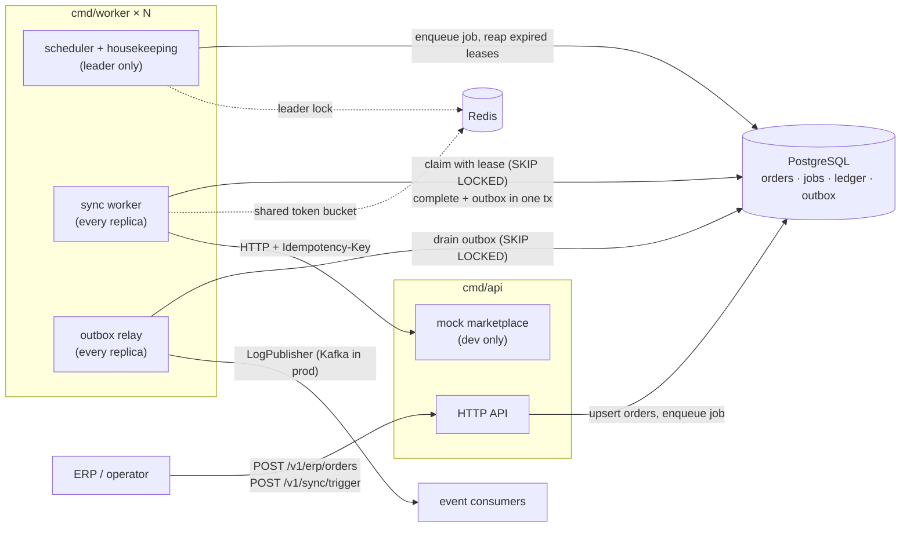

# OrderSync Platform

**Portfolio / learning project. Simulates ERP ↔ marketplace order sync with mock APIs.**

Not affiliated with any real marketplace. The marketplaces are called `wb_like` and `ozon_like`; both are an in-repo mock server, and no code here talks to a real vendor endpoint.

Two processes (`api`, `worker`), PostgreSQL, Redis. Go 1.26+.

## Problem

An ERP produces a steady stream of order changes that must reach marketplace APIs. Those APIs are rate-limited per token, occasionally return 5xx, and sometimes apply a write and then fail the response. The sync service has to:

1. Size its batches by how much fresh work exists, instead of polling a fixed `LIMIT`.
2. Stay inside a per-token, per-method request budget shared by all replicas.
3. Never apply the same change twice on the marketplace side, even across retries, crashes and timeouts.
4. Let any number of worker replicas run concurrently without double-processing.
5. Survive crashes: no order or job stays stuck in a "running" state forever.
6. Publish domain events reliably (transactional outbox), ready to be swapped for Kafka.

## Architecture



### Sync path for one order

1. The ERP pushes orders (`POST /v1/erp/orders`). An upsert stores a canonical JSON payload and its SHA-256 content hash. If the hash is unchanged, nothing happens; if it changed, the order goes back to `pending`.
2. The leader's scheduler sees claimable orders and enqueues a job. A partial unique index allows at most one queued job at a time.
3. A worker claims the job, counts claimable orders, and picks a batch size from that volume. It claims that many orders with `FOR UPDATE SKIP LOCKED`, and each claimed order gets a lease token and a deadline.
4. Orders are pushed with bounded concurrency (`errgroup.SetLimit`). Each call first takes a token from the Redis bucket for `marketplace:token:method`, then sends `Idempotency-Key = sha256(order|method|content_hash)`.
5. The result is written in one transaction: a ledger row, the order status fenced by `lease_token`, and an outbox event. If the lease was taken over in the meantime, the stale worker's status update is rejected.
6. A worker keeps draining batches until volume hits zero or `MAX_BATCHES_PER_JOB`. Every batch also renews the job lease.

### Packages

| Path | Responsibility |
|------|----------------|
| `cmd/api` | HTTP API, mounts the mock marketplace when `MOCK_MARKET_ENABLED=true` |
| `cmd/worker` | Sync worker, leader-elected scheduler, outbox relay, metrics/pprof on `:8081` |
| `cmd/loadgen` | Seeds N orders through the API and measures time-to-synced |
| `internal/domain` | Orders, jobs, events; validation and content hashing; no I/O |
| `internal/syncer` | Worker loop, adaptive batching, scheduler/housekeeping |
| `internal/store` | Postgres: leases, fenced completion, outbox, idempotency keys, embedded migrations |
| `internal/marketplace` | HTTP client: rate limit → call → classify (retryable / permanent) |
| `internal/limiter` | In-process token bucket (mock server) and Redis shared bucket (workers) |
| `internal/lock` | Redis lock with owner token, atomic extend/release, leader election |
| `internal/outbox` | Relay that drains the outbox to a `Publisher` |
| `internal/retry` | Retry policy with full-jitter backoff; only explicitly retryable errors retry |
| `internal/httpserver` | Routes, API-key middleware, HTTP idempotency, protected pprof |
| `internal/mockmarket`, `internal/mockerp` | Flaky rate-limited marketplace and order generator |
| `migrations/` | Versioned SQL, embedded into the binaries |

### Data model

| Table | Purpose |
|-------|---------|
| `orders` | Canonical state: `pending → syncing → synced`, or `failed` (retry with backoff) → `dead` after `MAX_ATTEMPTS`. Lease columns `lease_owner`, `lease_token`, `lease_until`. |
| `sync_jobs` | Work units with fresh volume, batch count, last batch size, counters, worker lease. |
| `sync_ledger` | Unique `(order_id, marketplace, method, content_hash)`: the remote side effect already happened. |
| `idempotency_keys` | HTTP `Idempotency-Key` with request hash, state and TTL. |
| `outbox_events` | Events written in the same transaction as the state change; `published_at` set by the relay. |
| `schema_migrations` | Applied migration versions (guarded by `pg_advisory_lock`). |

## Running it

Requires Docker. Nothing else is needed for the stack; Go 1.26+ is needed for tests and `loadgen`.

```bash
make up                 # api, 1 worker, postgres, redis, prometheus, grafana
make up-multi           # same with 2 worker replicas (WORKERS=3 make up-multi for more)
make seed               # 50 generated orders; the scheduler picks them up automatically
make loadgen ORDERS=2000
make down               # stop and drop volumes
```

| URL | What |
|-----|------|
| http://localhost:8080/healthz, `/readyz` | Liveness; readiness pings Postgres and Redis |
| http://localhost:8080/metrics | API and mock-marketplace metrics |
| http://localhost:9090 | Prometheus (discovers every worker replica via DNS) |
| http://localhost:3000 | Grafana, provisioned "OrderSync" dashboard (anonymous view; admin/admin) |
| http://localhost:8080/debug/pprof/ | pprof, needs `X-API-Key` (enabled in compose, off by default) |

All host ports bind to `127.0.0.1`. Postgres is on 5433 and Redis on 6380 to avoid clashing with local installs.

### API

Every `/v1` route requires the `X-API-Key` header (demo value `dev-local-key`). Query-string keys are rejected so they don't end up in access logs.

| Method | Path | Notes |
|--------|------|-------|
| `POST` | `/v1/erp/orders` | `{"orders":[{"external_id","marketplace","payload"}]}`, max 1000 per request. Returns `received` and `changed`. |
| `POST` | `/v1/demo/seed` | `{"count":N}` (up to 10000) generated orders |
| `POST` | `/v1/sync/trigger` | Enqueue a job now. Optional `Idempotency-Key`: replay returns 200 with the same job, a different body returns 422, an in-flight duplicate returns 409. |
| `GET` | `/v1/jobs`, `/v1/jobs/{id}` | Job history and counters |
| `GET` | `/v1/orders/{id}`, `/v1/orders?marketplace=&external_id=` | Order state, attempts, last error |
| `GET` | `/v1/stats` | Orders by status, claimable count, jobs by status, outbox backlog |

```bash
curl -sS -X POST localhost:8080/v1/erp/orders -H 'X-API-Key: dev-local-key' \
  -d '{"orders":[{"external_id":"ERP-1","marketplace":"wb_like","payload":{"sku":"A-1","qty":2}}]}'
curl -sS -X POST localhost:8080/v1/sync/trigger -H 'X-API-Key: dev-local-key' -H 'Idempotency-Key: demo-1'
curl -sS localhost:8080/v1/stats -H 'X-API-Key: dev-local-key'
```

### Configuration

12-factor: everything comes from environment variables, and [.env.example](.env.example) lists them with defaults. `API_KEY` and `POSTGRES_DSN` have no defaults, so the process refuses to start without them. Invalid values are reported all at once instead of silently falling back.

The values that matter most:

- `WB_LIKE_RPS`, `OZON_LIKE_RPS`: request budget per marketplace token, shared by all replicas.
- `MAX_CONCURRENCY`: number of in-flight calls per worker.
- `BATCH_MIN`, `BATCH_SOFT_LIMIT`, `BATCH_MAX`: bounds for adaptive batching.
- `MAX_ATTEMPTS`, `RETRY_BASE`, `RETRY_MAX`: order-level retry and dead-lettering.
- `ORDER_LEASE`, `ORDER_TIMEOUT`, `JOB_LEASE`, `LEADER_TTL`: crash-recovery timings.
- `SHUTDOWN_GRACE`: how long in-flight orders may finish after SIGTERM.
- `MOCK_FAIL_RATE`, `MOCK_LATENCY`: how badly the mock behaves.

## Design decisions

### Adaptive batching

`AdaptiveBatchSize(volume)` grows linearly from `BATCH_MIN` to `BATCH_SOFT_LIMIT` while volume is below the soft limit. Above it, the size ramps to `BATCH_MAX` and reaches it at 4× the soft limit. Small volumes get small batches, which means low latency, short critical sections and a small blast radius if a worker dies. A backlog gets large batches that amortise claim and bookkeeping queries. A job keeps draining batch after batch, so a backlog doesn't wait for the next scheduler tick.

### Leases and fencing instead of a global lock

Order claims use `FOR UPDATE SKIP LOCKED`, which lets replicas pick disjoint rows concurrently. A row lock only lives as long as its transaction, though, and HTTP calls must not run inside one. So the claim also writes a lease: a random `lease_token` plus `lease_until`.

- **Completion is fenced.** The status update matches on `lease_token`. A worker that paused (GC, network partition) past its lease cannot overwrite the work of the worker that reclaimed the order; it gets `ErrLeaseLost`. Its ledger row is still recorded, so the new owner skips the remote call.
- **Crash recovery.** Expired `syncing` leases become claimable again. An expired lease on the final attempt is dead-lettered by housekeeping, so a poison order cannot loop forever.
- **Jobs** have the same lease. `RecordBatch` acts as the heartbeat, and expired `running` jobs are closed as failed.

An earlier version serialised all workers behind one Redis lock around claiming. That made the second replica useless. The current design has no global mutex on the hot path.

### Why Redis is still used for locking

Redis does a job Postgres row locks can't: **leader election** for periodic duties (enqueuing jobs, reaping leases, purging old idempotency keys and published outbox rows). Only one replica should run those. Session-level `pg_advisory_lock` would work too, but it ties leadership to one pooled connection, and leadership silently vanishes if that connection is recycled. A Redis key with a TTL and an owner token is explicit:

- Extending and releasing are atomic Lua scripts that check the owner.
- If renewal fails, the leader's context is cancelled, so a deposed leader stops promptly.
- A dead leader is replaced within `LEADER_TTL`.

Correctness does not depend on the lock. A brief overlap of two leaders is harmless because every duty is idempotent (the single-queued-job index, fenced reaping). Redis is an optimisation and coordination tool here, not the source of truth.

### Rate limiting

The client side uses a token bucket in Redis (Lua; state in one hash per key `marketplace:tok-XXXX:method`). Every replica draws from the same budget, so adding workers does not multiply the request rate against a per-token quota. The token is masked in the key so it never appears in Redis.

The mock server enforces its own limit and answers `429` with `Retry-After-Ms`. The client honours that hint instead of its own backoff. Only `429`, `5xx` and network errors are retried; other `4xx` are permanent and fail the attempt immediately.

### Idempotency, in three layers

1. **Marketplace.** Every call carries `Idempotency-Key = sha256(order_id|method|content_hash)`. The mock fails half of its 5xx responses *after* applying the write ("ghost writes"). Without the key, the retry would create a duplicate. With it, the marketplace replays the original result. The benchmarks report remote duplicate writes, and that number must be 0.
2. **Ledger.** `sync_ledger` records that a given content version was pushed. A reclaimed order whose push already succeeded skips the remote call entirely.
3. **HTTP.** `POST /v1/sync/trigger` with `Idempotency-Key` stores a request hash and a state:
   - A replay returns the original job.
   - The same key with a different body returns `422`.
   - A concurrent duplicate returns `409`.
   - If enqueuing fails, the key is released. A key stuck in-progress (crashed request) can be taken over after a minute.

Content changes are tracked by hash, not by `updated_at`. An ERP re-sending an unchanged order is a no-op. A change that arrives while the order is in flight puts it back in `pending` once the current push completes.

### Outbox, and where Kafka fits

The order status, the ledger row and the outbox event commit in **one transaction**, so "synced but no event" and "event for an order that didn't sync" are impossible. Each worker replica runs a relay that drains in a transaction:

1. `SELECT … FOR UPDATE SKIP LOCKED`.
2. Publish the rows.
3. Mark them published and commit.

Concurrent relays never publish the same row at the same time. Delivery is **at-least-once**: a crash after publishing and before the commit republishes. Consumers dedupe by event `id`.

`LogPublisher` stands in for a broker. With Kafka:

- Implement `outbox.Publisher` with a producer, `acks=all` and an idempotent producer, using `aggregate_id` as the message key so per-order ordering is preserved.
- Keep the table and the relay exactly as they are, since the outbox exists to avoid the DB/broker dual write.
- At higher volume, replace polling with Debezium CDC on the outbox table.

### Graceful shutdown

On SIGTERM a worker:

1. Stops claiming new work.
2. Gives in-flight orders `SHUTDOWN_GRACE` to finish.
3. Cancels the remaining calls and *releases* those orders. A release doesn't consume an attempt.
4. Marks the job `cancelled` and steps down as leader.

Outcome writes use `context.WithoutCancel` with their own timeout, which starts *after* the remote call. A slow call can therefore never leave a successful push unrecorded. Compose sets `stop_grace_period: 30s` so Docker doesn't SIGKILL before the grace period ends.

### Observability

- **Logs.** `slog` JSON with `service`, `component`, `worker_id`, `order_id` and `job_id` fields. Request logs skip `/metrics` and the health probes.
- **Metrics** (prefix `ordersync_`):
  - Jobs finished by status.
  - Batch size histogram.
  - Orders processed by outcome.
  - Per-order sync duration and end-to-end lag from ingest to synced.
  - Fresh-orders gauge.
  - API calls by result, and call latency.
  - Retries by reason.
  - Rate-limit wait.
  - Leader gauge and lock-acquire latency.
  - Outbox published and backlog.
  - HTTP requests by route pattern (bounded cardinality).
- **pprof.** Off by default (`ENABLE_PPROF`) and behind the API key when on. The api serves it on `:8080`, the worker on `:8081`.

## Benchmarks

Measured with `cmd/loadgen` against the compose stack on an Apple M2 (8 cores) with Docker Desktop (8 CPUs, 8 GB). Mock latency was 25 ms and the mock fail rate 5% (half of the failures are ghost writes). Each run is one pass, so expect ±10% between runs.

| Scenario | Orders | Workers | Budget (wb / ozon) | Time | Throughput | Remote duplicates |
|----------|-------:|--------:|--------------------|-----:|-----------:|------------------:|
| Default limits | 2 000 | 1 | 20 / 30 rps | 52.1 s | 38.4 orders/s | 0 |
| Default limits | 2 000 | 2 | 20 / 30 rps | 52.1 s | 38.4 orders/s | 0 |
| High limits | 10 000 | 1 | 2000 / 2000 rps | 25.7 s | 390 orders/s | 0 |
| High limits | 10 000 | 2 | 2000 / 2000 rps | 13.4 s | 747 orders/s | 0 |
| Worker stopped mid-run | 1 500 | 2 → 1 | 20 / 30 rps | 39.4 s | 38.1 orders/s | 0 |

How to read these numbers:

- **Default limits.** The rate limit is the bottleneck, and adding a worker correctly changes nothing. Half of the orders go to `wb_like` at 20 rps, so the ceiling is about 40 orders/s. Two workers share one Redis budget and get no `429`s from the server. A per-process limiter would double the request rate and get throttled.
- **High limits.** Concurrency is the bottleneck: 16 in-flight calls × ~40 ms per order. The second worker almost doubles throughput because replicas claim disjoint orders and don't serialise on a lock.
- **Worker stopped mid-run.** The stopped replica, which was the leader, finished its batch within the grace period, marked its job `cancelled` and released leadership. The other replica took over the scheduler in about 1 s, and every order was synced exactly once.

Reproduce:

```bash
make up                                   # or: make up-multi
make loadgen ORDERS=2000
WB_LIKE_RPS=2000 OZON_LIKE_RPS=2000 make up-multi
make loadgen ORDERS=10000
```

`loadgen` exits non-zero if the mock marketplace saw a duplicate write. While it runs, watch the Grafana dashboard or these queries:

- `sum by (outcome) (rate(ordersync_orders_processed_total[1m]))`: throughput, and whether anything is failing or being released.
- `histogram_quantile(0.95, sum by (le, marketplace) (rate(ordersync_rate_limit_wait_seconds_bucket[1m])))`: if this is high, you are limit-bound, not CPU-bound.
- `sum by (result) (rate(ordersync_marketplace_api_calls_total[1m]))`: `rate_limited` should stay near 0 with any number of replicas; `replayed` counts the ghost writes that idempotency absorbed.
- `ordersync_batch_size`: grows with backlog and shrinks as it drains.
- `ordersync_order_end_to_end_lag_seconds`: time from ingest to synced, which is the number the business cares about.
- `ordersync_fresh_orders`, `ordersync_outbox_backlog`: queue depths; both should return to 0.

Micro-benchmarks for the pure functions: `make bench`.

## Development

```bash
make test               # unit tests, -race
make test-integration   # Postgres + Redis via testcontainers (Docker required)
make lint               # golangci-lint v2, pinned in the Makefile; no global install needed
```

To run the binaries outside Docker, start only the dependencies with `docker compose up -d postgres redis`, export the variables from `.env.example`, then `go run ./cmd/api` and `go run ./cmd/worker`.

The integration suite runs against real Postgres and Redis. It covers:

- Two full replicas syncing 300 orders against a 30% failing mock with zero duplicate writes and exactly one event per order.
- Lease expiry and fencing.
- Content changes during a sync.
- Dead-lettering.
- Concurrent triggers.
- Concurrent outbox relays.
- Concurrent migrations.
- The idempotency-key lifecycle.

CI (GitHub Actions) runs lint, `go mod tidy` drift, unit tests with `-race`, the integration tests and a Docker build.

## Interview talking points

| Topic | What to discuss |
|-------|-----------------|
| Leases vs locks | Why `SKIP LOCKED` alone isn't enough when work outlives the transaction; fencing tokens; what happens on a GC pause longer than the lease |
| Leader election | Redis TTL + owner token vs `pg_advisory_lock`; why correctness must not depend on the lock (idempotent duties) |
| Rate limits | Per-process vs shared bucket; per-token, per-method keys; honouring `Retry-After`; client clock trust in the Lua script |
| Adaptive batching | Latency vs throughput; how batch size bounds the blast radius of a crash |
| Idempotency | Ghost writes; why a local ledger alone can't prevent remote duplicates; content hash vs version; HTTP key states |
| Outbox | Dual-write problem; at-least-once vs exactly-once; Kafka keying and ordering; CDC |
| Failure handling | Retryable vs permanent errors; attempts and dead-lettering; backoff with full jitter; what to page on |
| Shutdown | Draining without losing work; why persistence uses `WithoutCancel`; `stop_grace_period` |
| Testing | Fakes for decision logic, miniredis for Lua, testcontainers for SQL semantics and the end-to-end invariant |

More in [CONTRIBUTING.md](CONTRIBUTING.md).

## Limitations

- The mock marketplace keeps its state in memory inside the api process; restarting the api resets its duplicate counters.
- The Redis limiter trusts the caller's clock. Replicas are assumed to be NTP-synced, and skew shows up as small overshoot that the server's `429` absorbs.
- Within one order, ordering is by content version; there is no cross-order ordering guarantee, and none is needed for upserts.
- A successful push whose completion cannot be persisted (database down) waits for its lease to expire. The retry then replays the idempotency key, so the remote side stays clean but latency suffers.

## Explicit non-goals

- Real Wildberries / Ozon / Yandex credentials, endpoints or private-API scraping.
- Microservices or a service mesh: two binaries are enough.
- Auth beyond a demo API key.
- "Millions of users" claims; the numbers above are local and reproducible.

## License

MIT, see [LICENSE](LICENSE).
