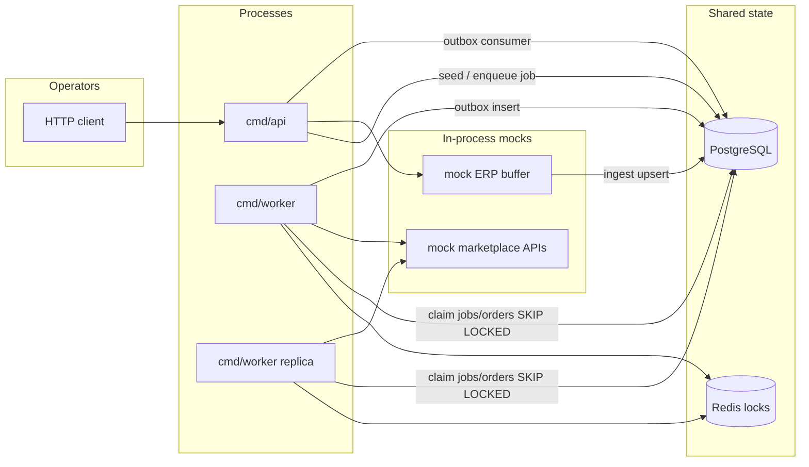

# OrderSync Platform

**Portfolio / learning project. Simulates ERP ↔ marketplace order sync with mock APIs.**

Not affiliated with any real marketplace. Mock clients intentionally use names like `wb_like` / `ozon_like` and never talk to real vendor endpoints.

Requires **Go 1.26+** (module toolchain). This repository is a production-shaped sample that demonstrates senior backend Go skills: concurrency, rate limiting, adaptive batching, idempotency, distributed locking, the transactional outbox pattern, observability, tests, and clean package boundaries.

## Problem

Internal ERP systems accumulate fresh order changes. Marketplace APIs are rate-limited and occasionally flaky. A sync worker must:

1. Observe **volume** of fresh order data (not a fixed poll size)
2. Choose an **adaptive batch size**
3. Call marketplace-like APIs under **per-token / per-method** rate limits
4. Persist side effects **idempotently** so retries do not double-apply
5. Allow **two worker replicas** to share Postgres + Redis without double-processing
6. Emit domain events via a **Postgres outbox** (in-process consumer here; Kafka-ready)

## Architecture



### Package layout

| Path | Responsibility |
|------|----------------|
| `cmd/api` | HTTP API, health/ready, trigger sync, inspect jobs/orders, pprof, metrics |
| `cmd/worker` | Job loop, bounded concurrency, outbox consumer, metrics |
| `internal/domain` | Orders, jobs, events — no I/O |
| `internal/sync` | Orchestration + adaptive batching |
| `internal/limiter` | Token-bucket rate limiter |
| `internal/lock` | Redis distributed lock |
| `internal/outbox` | In-process outbox publisher |
| `internal/store` | Postgres repositories |
| `internal/metrics` | Prometheus instrumentation |
| `internal/mockerp` / `internal/mockmarket` | Fake ERP + flaky rate-limited APIs |
| `migrations/` | SQL schema |

### Data model (Postgres)

- **orders** — canonical sync state (`pending` → `syncing` → `synced`/`failed`)
- **sync_jobs** — batch work units with volume + chosen batch size
- **sync_ledger** — idempotency of marketplace side effects `(order, method, content_hash)`
- **idempotency_keys** — HTTP trigger replay (`Idempotency-Key`)
- **outbox_events** — transactional-ish domain events (`published_at` when drained)

## Quick start

```bash
# requires Docker
make up

# seed 50 mock ERP orders + enqueue a sync job
make seed

# or
curl -sS -X POST localhost:8080/v1/sync/trigger \
  -H 'Content-Type: application/json' \
  -H 'X-API-Key: dev-local-key' \
  -H 'Idempotency-Key: demo-1' \
  -d '{"seed":100}'
```

Two workers (optional):

```bash
make up-multi   # docker compose --profile multi
```

Useful URLs:

| URL | Purpose |
|-----|---------|
| http://localhost:8080/healthz | liveness |
| http://localhost:8080/readyz | Postgres readiness |
| http://localhost:8080/metrics | Prometheus metrics (API) |
| http://localhost:9090 | Prometheus UI |
| http://localhost:8080/debug/pprof/ | pprof (API key required) |

Local API key (demo only): `dev-local-key` via `X-API-Key`.

## Design decisions

### Adaptive batching

Batch size is a function of **fresh order volume** (`pending`/`failed` rows), not a fixed poll:

- low volume → smaller batches (lower latency)
- above a soft limit → grow toward `BATCH_MAX` (better API amortization)

See `internal/sync/batching.go`.

### Rate limiting

In-process **token bucket** keyed by `marketplace:token:method`. Each worker process owns its allowance (matches “per API token” demos). A production multi-instance limiter would store counters in Redis; the interface stays the same.

### Distributed locking (Redis)

Workers take a Redis `SET NX PX` lock around job claiming. **Why Redis over Postgres advisory locks:**

1. TTL + owner token fit crash recovery cleanly
2. Keeps OLTP Postgres free of coordination churn
3. Common pattern for marketplace integration workers

Orders/jobs also use `FOR UPDATE SKIP LOCKED` so the DB remains a second safety net.

### Idempotency

1. **sync_ledger** — if `(order_id, marketplace, method, content_hash)` already exists, skip the marketplace call and mark synced
2. **HTTP Idempotency-Key** — replay returns the same job for duplicate triggers
3. Retries use exponential backoff + full jitter (`internal/retry`)

### Outbox (and where Kafka fits)

Workers insert events into `outbox_events` after sync outcomes. An in-process consumer marks rows `published_at` after logging/handling them.

In a Kafka-based deployment:

1. Keep the **same outbox table** written in the same DB transaction as business state (here: adjacent writes; easy to wrap in `WithTx`)
2. Replace the in-process consumer with a publisher that writes to a Kafka topic
3. Downstream services consume Kafka; retries stay at the outbox row until publish succeeds

Redis Streams is an alternative bus; the outbox still protects against “DB commit succeeded, bus write failed”.

### Observability

Prometheus metrics include jobs processed, batch size histogram, marketplace API calls, retries, lock wait, sync latency, outbox publishes. Structured logs via `slog` (JSON). pprof is mounted under `/debug/pprof` and protected by the demo API key.

## Benchmarks / load demo

```bash
make up
make bench-load   # seeds 200 orders and enqueues a job
```

Then inspect:

```bash
curl -s localhost:8080/metrics | grep ordersync_
```

Metrics worth watching:

- `ordersync_batch_size` — adaptive sizing under load
- `ordersync_marketplace_api_calls_total` — ok vs error
- `ordersync_retries_total` — mock flakiness
- `ordersync_lock_wait_seconds` — contention with `make up-multi`
- `ordersync_sync_latency_seconds` — end-to-end order latency

Tune locally via env: `MOCK_FAIL_PCT`, `WB_LIKE_RPS`, `OZON_LIKE_RPS`, `MAX_CONCURRENCY`, `BATCH_*`.

## Development

```bash
cp .env.example .env
# start only deps if developing binaries locally:
docker compose up -d postgres redis
# host ports: Postgres 5433, Redis 6380 (avoid clashes with local installs)

go mod tidy
make test
make lint   # requires golangci-lint
```

Integration tests (Docker required):

```bash
go test ./internal/sync -tags=integration -count=1
```

## Interview talking points

| Topic | What to discuss |
|-------|-----------------|
| Rate limits | Token bucket vs sliding window; per-method keys; shared Redis limiter for multi-instance fairness |
| Adaptive batching | Why fixed `LIMIT 100` is wrong when fresh volume varies; soft/hard caps; backpressure |
| Locks | Redis lock TTL + fencing token; `SKIP LOCKED` as DB-level mutual exclusion; when advisory locks win |
| Outbox | Dual-write problem; at-least-once publish; Kafka consumer groups; idempotent consumers |
| Idempotency | Content hash vs version; ledger unique keys; HTTP Idempotency-Key semantics |
| Concurrency | `errgroup` + weighted semaphore; graceful shutdown; not canceling sibling orders on one failure |
| Testing | Unit tests for pure logic; miniredis for locks; testcontainers for full path |

## Explicit non-goals

- Real Wildberries / Ozon / Yandex credentials or private API scraping
- Microservice mesh / service mesh theatre
- Fake “millions of users” claims — use the local load path above instead

## License

MIT — see [LICENSE](LICENSE).
